# GTA by Claude

**Mini-GTA w przeglądarce.** Miasto na wyspie: 12 × 12 kwartałów z ruchem ulicznym, pieszymi, rowerzystami i piratami drogowymi, dwie autostrady na estakadach z węzłem koniczynowym, lotnisko miejskie i port z łodziami, a za cieśniną wysepka z drugim lotniskiem — samolotami z obu można latać (i z których można wyskoczyć ze spadochronem), a po drugich pasach kursuje ruch lotniczy NPC. Po morzu pływają łodzie NPC, a na wschodzie wyspy jest duży park rozrywki z kolejkami górskimi, którymi można się przejechać. Do tego pełna mapa z wyznaczaniem trasy, cykl dnia i nocy, broń (pistolet, karabin, RPG) z kamerą zza ramienia, wybuchające pojazdy, koty na chodnikach i kradzież aut.

Wszystko — asfalt, okna, modele aut i samolotów, znaki, dźwięk silnika i wybuchów — jest generowane w kodzie. Nie ma ani jednego pliku graficznego czy dźwiękowego, nie ma bundlera ani serwera: wystarczy otworzyć `index.html`.

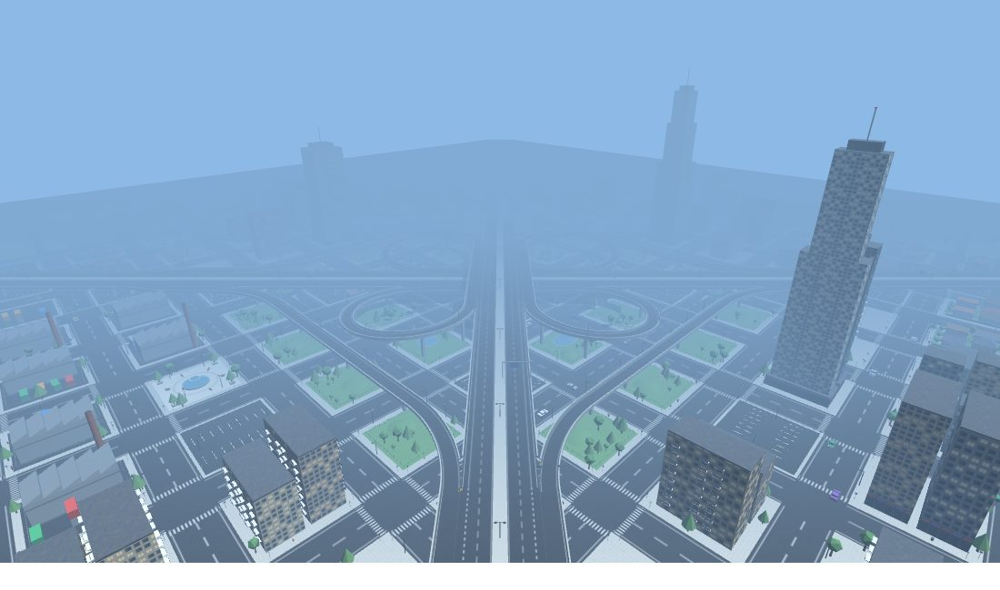

| Ulica w centrum | Noc | Węzeł koniczynowy |
|---|---|---|
| 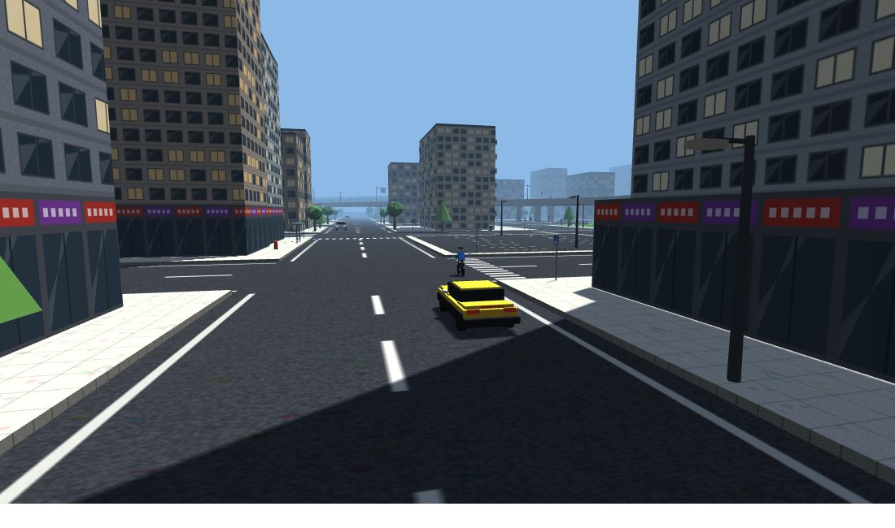 | 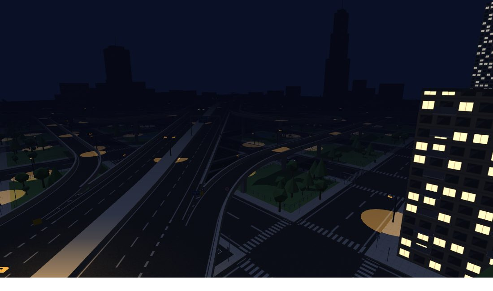 | 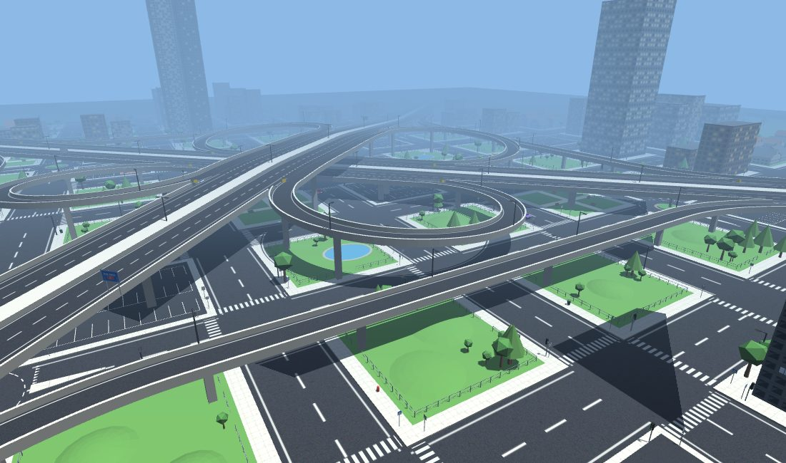 |

## Jak zagrać

1. Pobierz repozytorium (`Code → Download ZIP` albo `git clone`).
2. Otwórz `index.html` w Chrome, Edge, Firefoksie albo Safari (dwuklik wystarczy).
3. Poczekaj na koniec ekranu ładowania i kliknij **WEJDŹ DO MIASTA**.

Potrzebny jest internet, bo Three.js i cannon.js ładują się z CDN. Jeśli wolisz serwer lokalny: `npx serve` albo `python3 -m http.server` w katalogu projektu.

## Sterowanie

Klawisze można zmienić w menu (**STEROWANIE**). `Esc` w trakcie gry to pauza — świat stoi, dźwięk cichnie.

**Pieszo**

| Klawisz | Akcja |
|---|---|
| `W` `A` `S` `D` / strzałki, mysz | ruch, kamera |
| `Shift` / `Spacja` | bieg / skok |
| `F` (albo `E`) | wsiądź do auta lub samolotu, ukradnij auto NPC, przejażdżka w parku rozrywki (przy wejściu na atrakcję) |
| `V` (przytrzymaj) | menu pojazdów: twoje auto (zwykły, pickup, sportowy) albo rower |
| `1` … `5`, `Q` (przytrzymaj) | broń: pięści, kij, pistolet, karabin, RPG / koło broni |
| lewy przycisk myszy (karabin: przytrzymaj), `R` | atak, strzał / przeładowanie |
| prawy przycisk myszy | przycelowanie (bliżej, mniejszy rozrzut, wolniejszy chód) |

**W aucie**

| Klawisz | Akcja |
|---|---|
| `W` `S` / strzałki | gaz, hamulec, wsteczny |
| `A` `D` / strzałki | skręt |
| `Spacja` | hamulec ręczny (drift) |
| `Q` / `E` | lewy / prawy kierunkowskaz (gaśnie sam po skręcie) |
| `H` | klakson — auto stojące przed tobą rusza |
| `R` | postaw auto na koła |
| `F` | wysiądź |

**W samolocie**

| Klawisz | Akcja |
|---|---|
| `W` / `S` | więcej / mniej gazu |
| `↑` / `↓` | w górę / w dół (puszczone — samolot sam wraca do lotu poziomego) |
| `←` / `→` | skręt w przechyle (puszczone — skrzydła się wyrównują) |
| `A` / `D` | kołowanie po ziemi |
| `Spacja` | hamulce kół |
| `F` | wysiądź na ziemi, **w locie — skok ze spadochronem** |

**Łodzią** (wsiadasz `F` z pomostu): `W` / `S` — naprzód / wstecz, `A` / `D` — ster, `Spacja` — hamowanie, `F` — wysiadka przy pomoście lub nabrzeżu.

**Na spadochronie**: `A` / `D` — skręt (czasza się przechyla), `W` — szybciej i stromiej, `S` — hamowanie (wolniej i łagodniej). Lądowanie jest bezpieczne.
| mysz | rozglądanie się (kamera wraca za ogon) |

Jak wystartować: ustaw samolot na pasie, trzymaj `W`, a gdy prędkościomierz pokaże ok. 160 km/h (awionetka ok. 85 km/h) — `↑`. Jak wylądować: podejdź nad pas na kilkadziesiąt metrów, zdejmij gaz (`S`) i puść strzałki — asystent lądowania sam zniży lot i łagodnie przyziemi, potem `Spacja`.

**Zawsze**: `M` — mapa (prawy klik ustawia cel, trasa pojawia się na minimapie), `T` — szybszy upływ doby, `N` — wyciszenie, `` ` `` — menu debug.

## Co jest w grze

### Wyspa, port i łodzie

| Wyspa i morze | Port | Łódź |
|---|---|---|
| 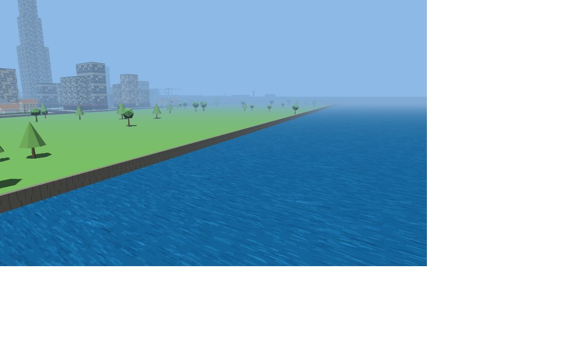 | 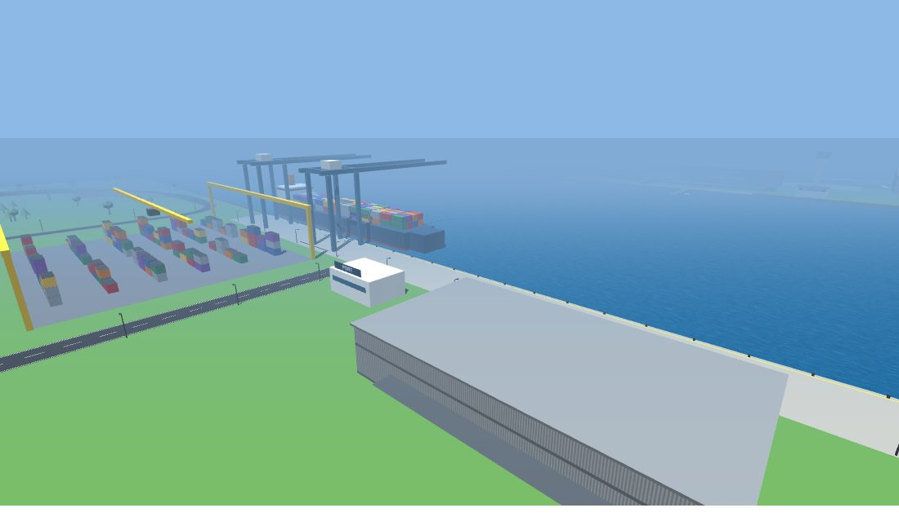 | 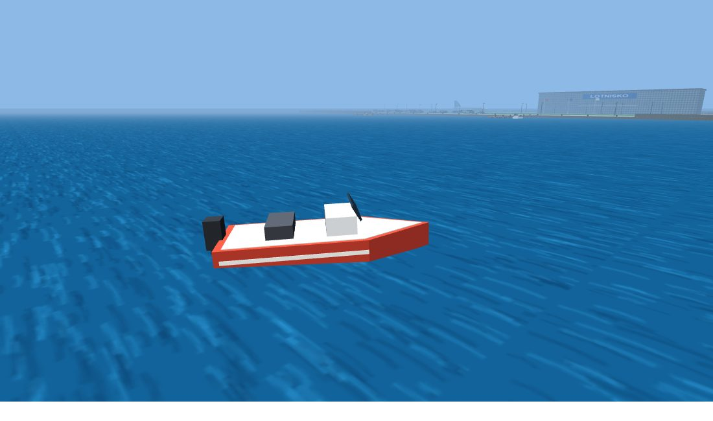 |

| Przystań na wysepce | Mewy nad miastem | Łódź NPC |
|---|---|---|
| 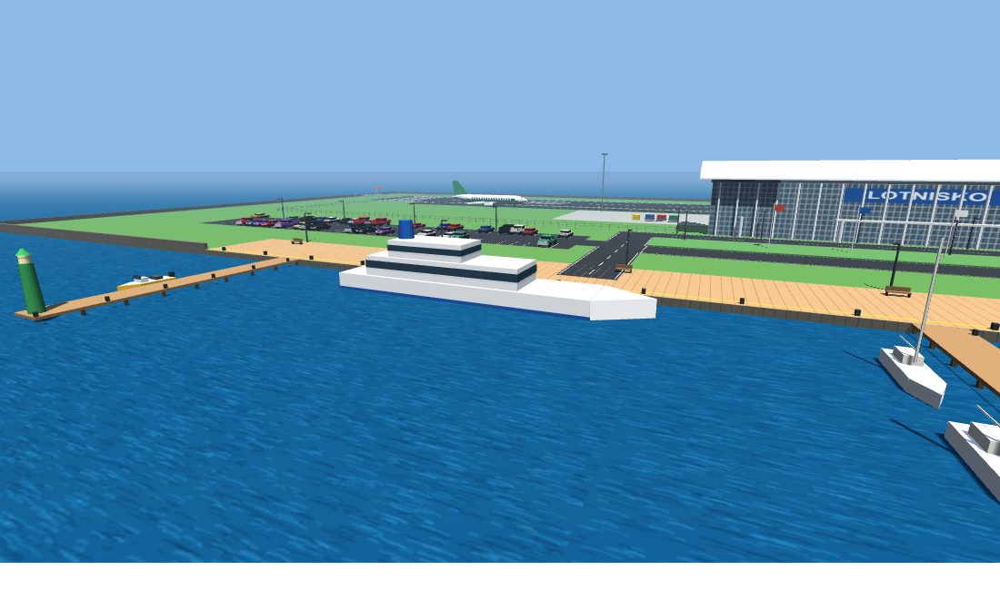 | 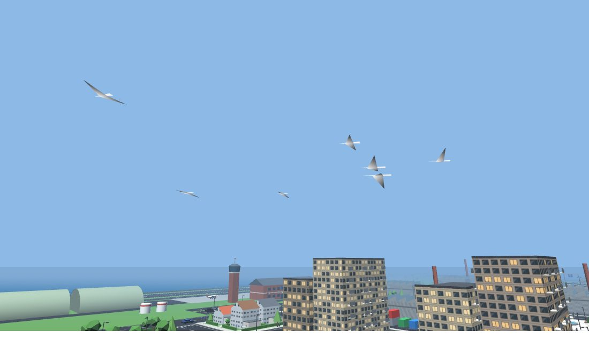 | 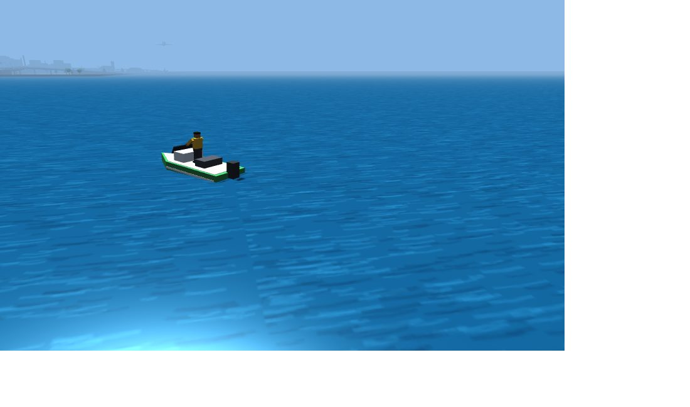 |

- Miasto leży na wyspie otoczonej morzem, z nabrzeżem i balustradą dookoła.
- Na północnym brzegu jest **port towarowy**: plac kontenerowy z suwnicą, dwa dźwigi nabrzeżowe, statek kontenerowy i holownik, zbiorniki paliw, magazyn, biuro portu, przystań z motorówkami i falochron z biało-czerwoną latarnią.
- Po morzu wokół wysp pływają **łodzie NPC** ze sternikami: między losowymi punktami, z dala od brzegu, omijają ląd, statek, pomosty i inne łodzie (także twoją). Łódź NPC przy pomoście można przejąć (`F`).
- Na wysepce jest **przystań pasażerska**: drewniany deptak, kasa biletowa z czerwonym dachem, ławki, prom, jachty i latarnie wejścia (zielona i czerwona).
- Nad miastem i portem latają **mewy**. Co jakiś czas któraś „zrzuca balast”: na ziemi albo dachu zostaje biała plama, która po kilku sekundach znika. Trafienie w ciebie albo w szybę auta kończy się komunikatem i plamą na ekranie.
- Za cieśniną, ok. 250 m na północ, leży **wysepka z drugim lotniskiem** i własną przystanią. Dopłyniesz tam łodzią z portu albo dolecisz samolotem z lotniska miejskiego.
- Kto wpadnie do wody (pieszo albo autem), zostaje wyciągnięty na brzeg; auto ląduje obok. Samolot, który dotknie wody, rozbija się i tonie.

### Park rozrywki

| Park z lotu ptaka | Brama | Plac z fontanną | Przejażdżka kolejką |
|---|---|---|---|
| 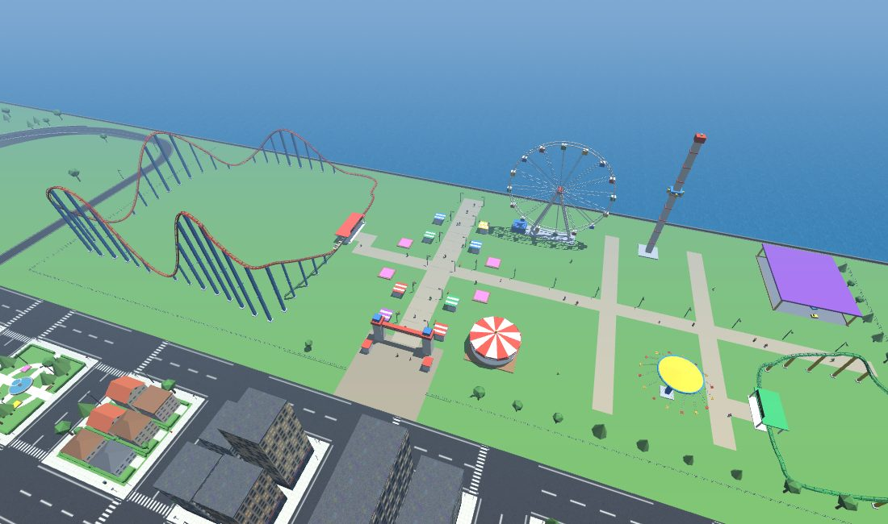 | 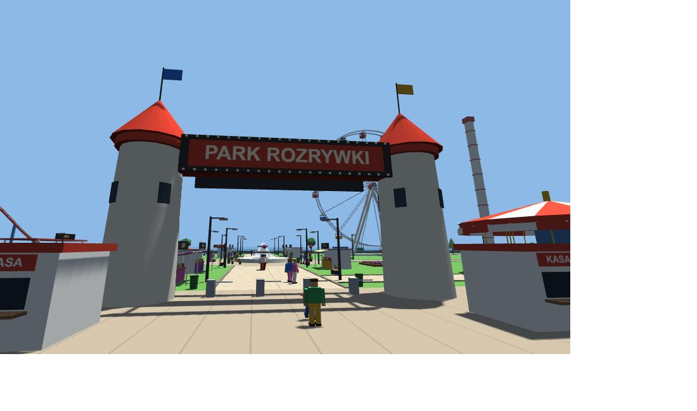 | 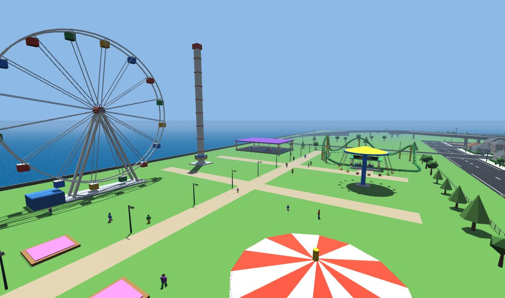 | 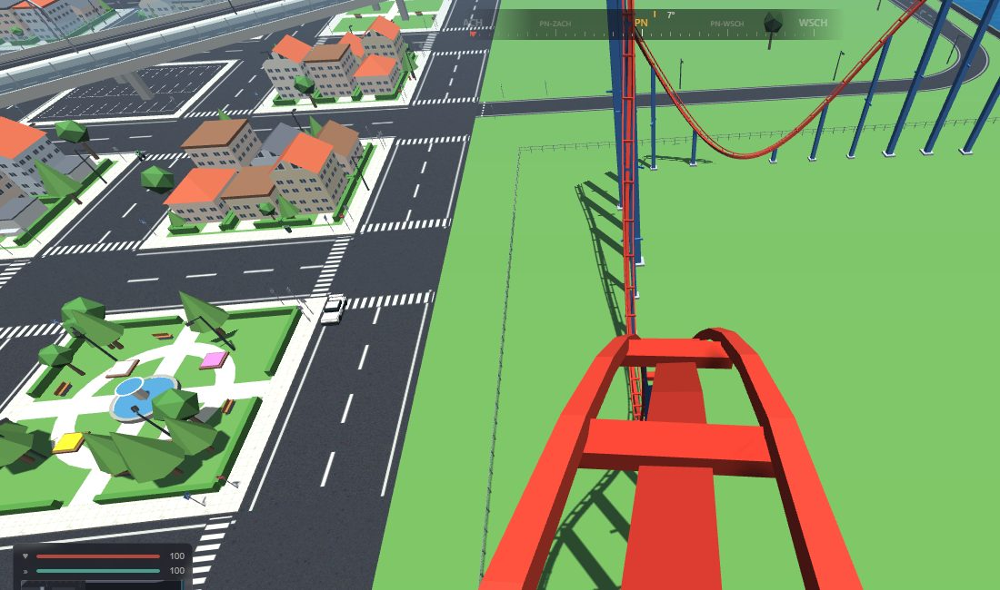 |

- We wschodnim pasie zieleni wyspy głównej (112 × 320 m). Każda atrakcja ma bramkę wejściową (łuk z nazwą, kolorowa posadzka, flagi, tabliczka, barierki kolejki). Zwiedzający chodzą tylko alejkami. Brama z dwiema wieżami, flagami i podświetlaną tablicą, kasy, kołowrotki. Alejki z krawężnikami, plac z fontanną, budki z szyldami i markizami (lody, wata, hot dog, popcorn…), stoliki z parasolami, ławki, kosze, klomby, żywopłoty, drogowskazy, tablice i barierki przy atrakcjach, spacerujący zwiedzający (niektórzy z balonikami); całość można obejść pieszo.
- **Kolejka SMOK** (370 m toru, wyciąg na 42 m, pierwszy zjazd ok. 70°, do 103 km/h, trzy górki o malejącej wysokości, tor przechylony w zakrętach) i rodzinna **kolejka ŻABKA** (142 m, 12 m, do 53 km/h). Pociągi jeżdżą cały czas z pasażerami.
- **Diabelski młyn** (średnica 42 m, 16 gondoli zawsze w pionie), **karuzela z konikami**, **karuzela łańcuchowa** (krzesełka odchylają się z prędkością), **wieża swobodnego spadania** (52 m: powolny wjazd, zawis, spadek), **autodrom**.
- **Przejażdżki** — `F` przy wejściu na atrakcję (podpowiedź na ekranie):
  - kolejki: gdy pociąg stoi na stacji, jazda z perspektywy pierwszego wagonu (kamera wygładzona, tor przechylony w zakrętach); po okrążeniu wysiadasz na peron;
  - diabelski młyn: gondola, która jest przy peronie, jeden pełny obrót;
  - wieża, karuzela, karuzela łańcuchowa: wsiadanie na postoju, wysiadka po zakończeniu jazdy;
  - autodrom: prowadzisz samochodzik (`W` / `S` / `A` / `D`), odbijasz się od band i innych aut, `F` — wysiadka w dowolnej chwili.
  - Mysz rozgląda się, licznik pokazuje prędkość i wysokość.

### Mapa i nawigacja

| Pełna mapa z trasą | Strzałka nad lotniskiem |
|---|---|
| 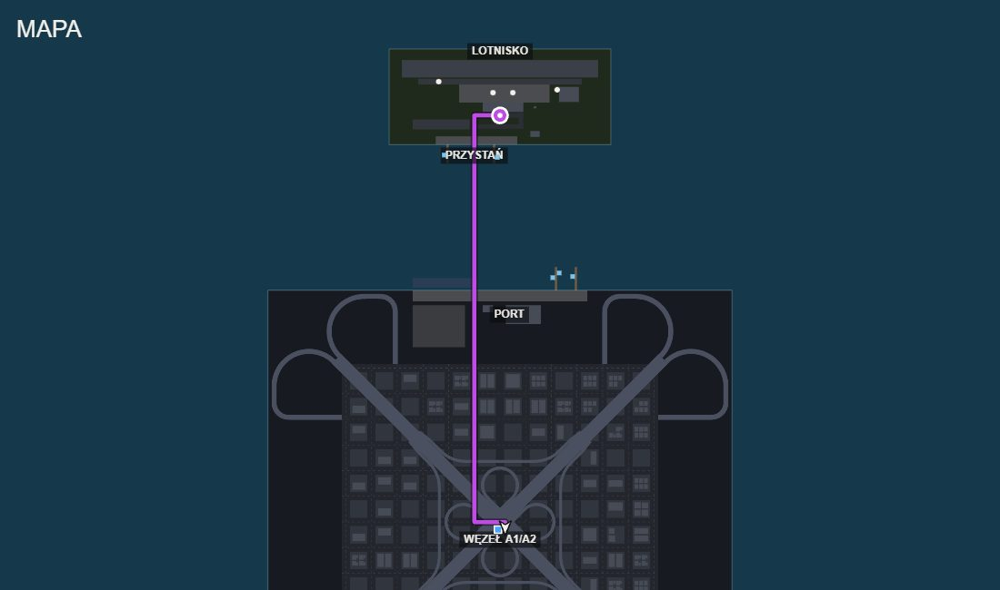 | 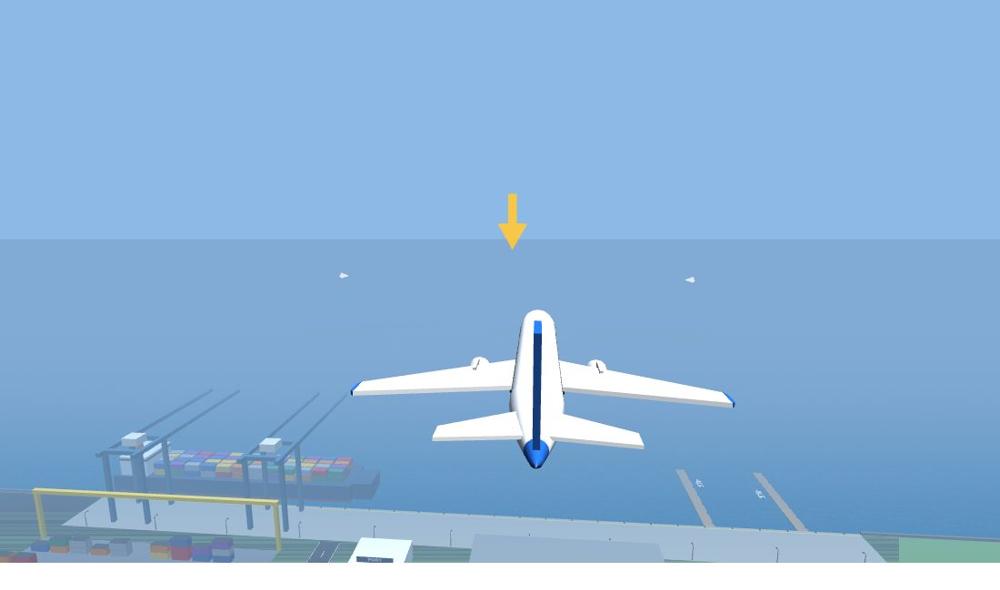 |

- `M` otwiera mapę całego świata (gra stoi): kółko przybliża, przeciąganie przesuwa, **prawy klik ustawia fioletowy znacznik celu** (drugi klik na znaczniku go usuwa).
- Trasa prowadzi pieszo i autem **po drogach** (autem z poszanowaniem jednokierunkowej obwodnicy), na drugą wyspę — przez przystanie, a samolotem i łodzią — w linii prostej. Widać ją na minimapie i mapie, a w świecie stoi fioletowy słup celu.
- W samolocie nad oboma pasami startowymi unoszą się żółte strzałki widoczne z daleka, a nad progami — strzałki kierunku podejścia.

### Miasto

| Rondo | Ulica pod estakadami | Park |
|---|---|---|
| 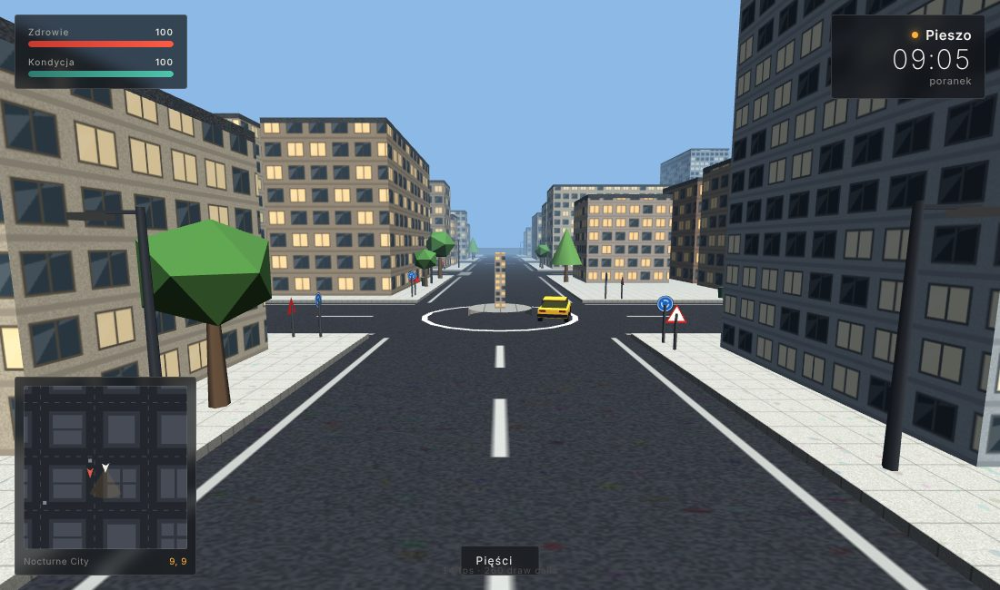 | 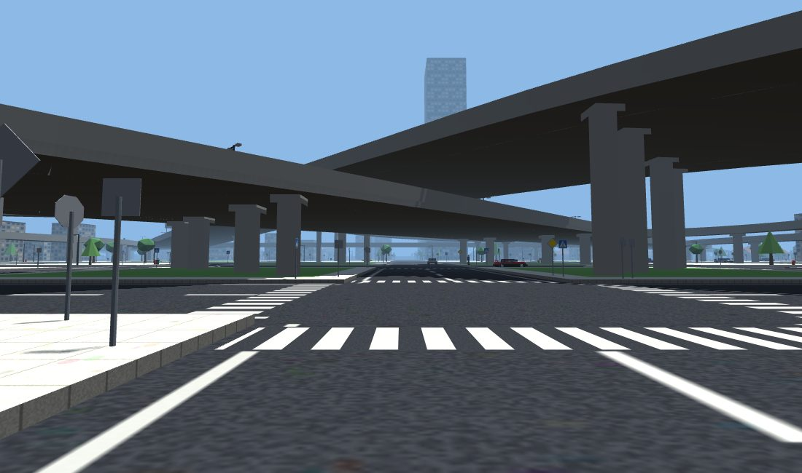 |  |

- **Dzielnice**: centrum z wieżowcami i placem z fontanną, dzielnica handlowa z galerią i parkingiem, przemysłowa (hale, kominy, kontenery), osiedla bloków z balkonami i domki z ogródkami i garażami. Do tego parki ze stawami i placami zabaw, stacja paliw, przystanki.
- **Autostrady A1 i A2** biegną estakadami po przekątnych miasta, z ulicami pod wiaduktami. W centrum — węzeł koniczynowy z pętlami, łącznicami i jezdniami zbierającymi, w narożnikach miasta zjazdy schodzące do poziomu ulic.
- **Przepisy i znaki**: ponad 970 znaków (STOP, ustąp pierwszeństwa, limity, strefa 30, droga z pierwszeństwem, zakaz wjazdu rowerów na autostradę i inne), sygnalizacja świetlna, ronda, jednokierunkowa obwodnica.
- **Dzień i noc**: słońce, księżyc, mgła, latarnie z plamami światła, oświetlone okna wieżowców.

### Ruch uliczny

| Pirat drogowy | Rowerzysta | Typy aut |
|---|---|---|
| 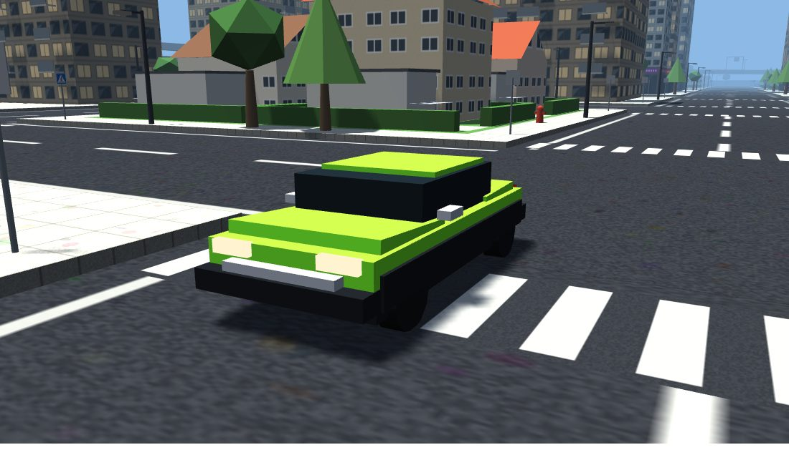 | 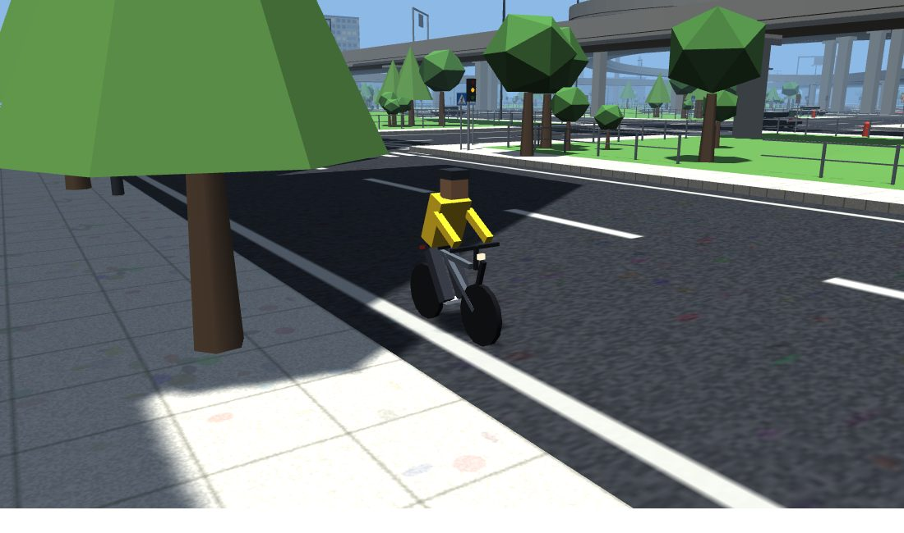 | 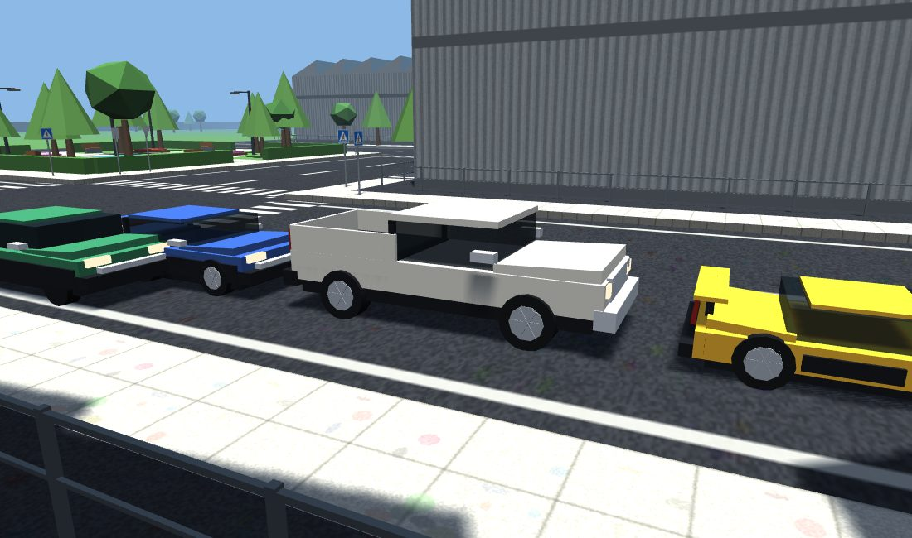 |

- **Auta NPC** (zwykłe, pickupy, sportowe; kierowcy ostrożni, zwykli i dynamiczni) jeżdżą prawostronnie, stają na czerwonym i na STOP, ustępują pierwszeństwa, objeżdżają ronda, włączają kierunkowskazy, wyprzedzają lewym pasem na autostradzie, omijają zaparkowane auta. Po stłuczce stają na światłach awaryjnych, na strzały uciekają.
- **Piraci drogowi** — kwasowo zielone auta (także na minimapie) z podrasowanym silnikiem. Nie przestrzegają żadnych przepisów: jadą na czerwonym, bez pierwszeństwa, praktycznie z prędkością maksymalną, slalomem, wyprzedzają przeciwnym pasem nawet na przejściach i potrącają pieszych i rowerzystów.
- **Rowerzyści** jeżdżą przy prawej krawędzi jezdni, auta wymijają ich z odstępem.
- **Piesi** spacerują po chodnikach i przechodzą po pasach (na światłach w swojej fazie).

### Ty

| HUD w aucie | Karabin zza ramienia | Szpital |
|---|---|---|
| 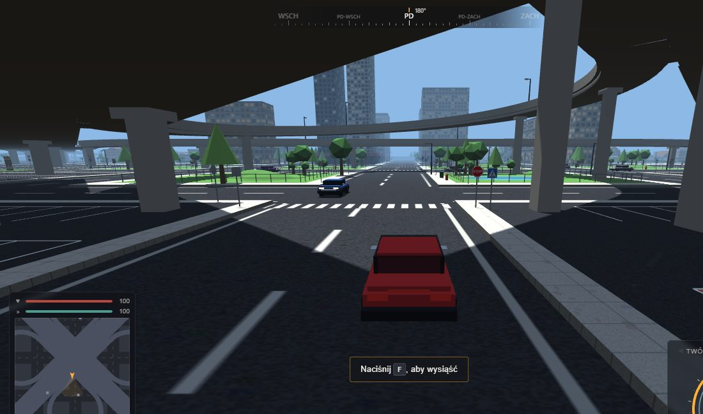 | 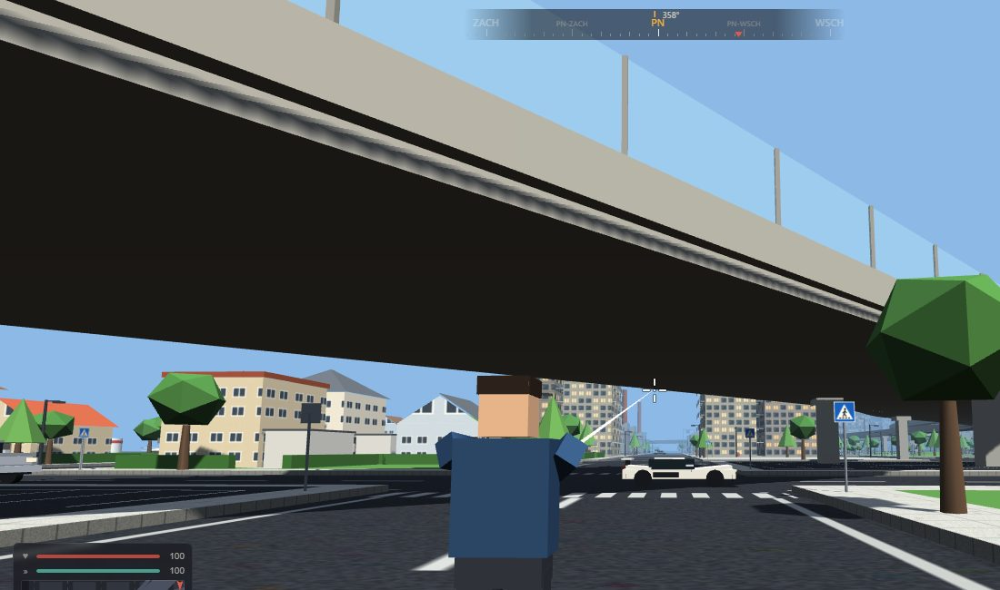 | 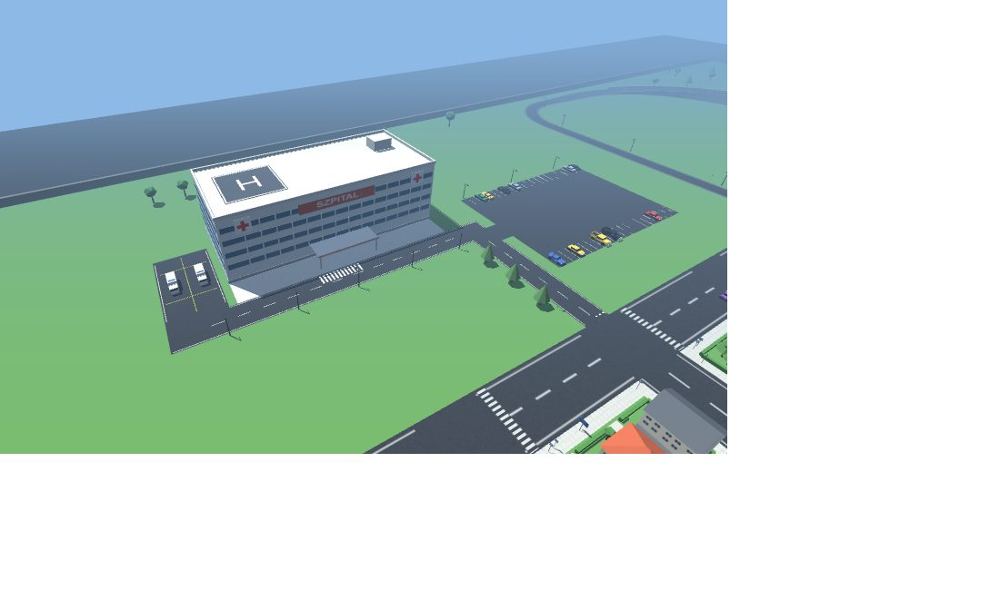 |

| RPG — wybuch | Wrak | Koty |
|---|---|---|
| 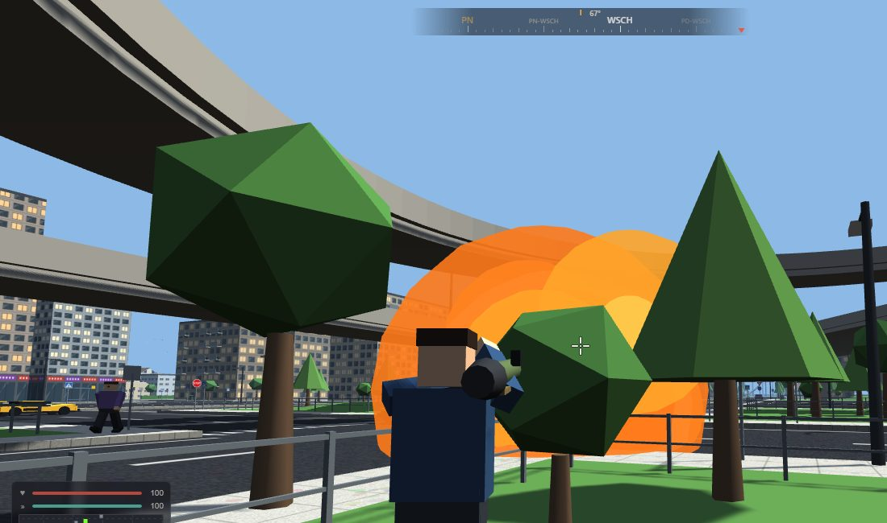 | 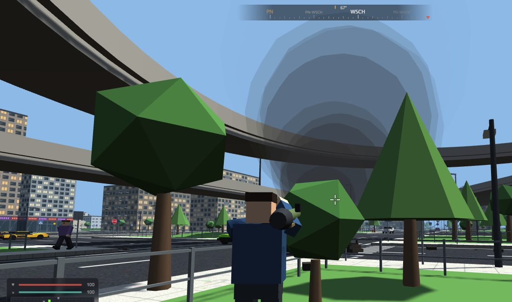 | 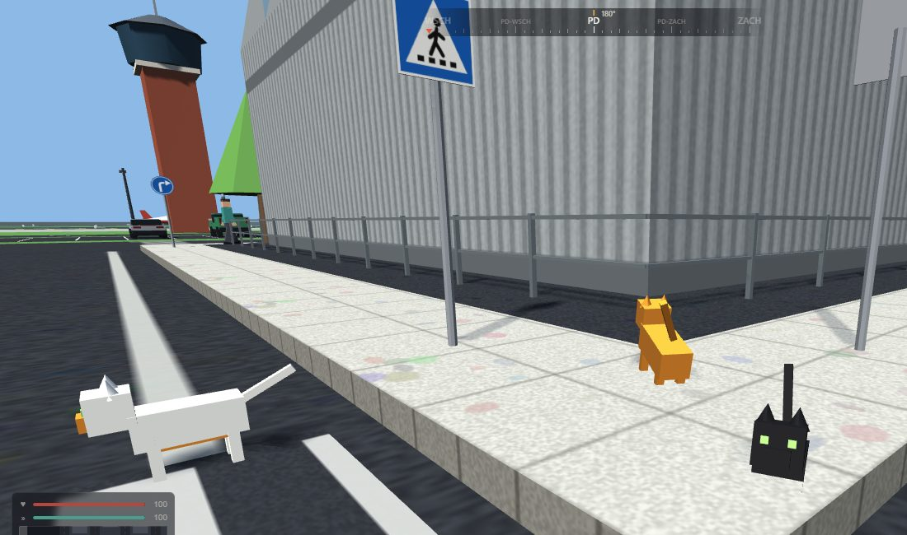 |

- Jazda z fizyką zawieszenia. Trzy typy aut: zwykły (0–100 km/h w 4,4 s, 181 km/h), pickup (6,9 s, 160 km/h), sportowy (3,0 s, 250 km/h), do tego rower. Twoje auto przywołujesz menu `V`, skradzione zostają tam, gdzie je porzucisz.
- Broń: pięści, kij, pistolet i karabin (ogień ciągły, magazynek 30). Z bronią palną kamera przechodzi za prawe ramię — postać jest z lewej i nie zasłania celownika na środku ekranu, a obraca się w stronę celownika. Strzał leci przez środek celownika (z kontrolą, czy przed lufą nie ma ściany); rozrzut rośnie w ruchu i przy serii, odrzut podbija kamerę; smugacz, błysk, iskry na metalu, pył na murze, znacznik trafienia. Strzały w auto NPC zatrzymują je na światłach awaryjnych.
- **RPG**: rakieta leci w punkt pod celownikiem (z dymem), wybucha przy trafieniu w cokolwiek — jedna rakieta niszczy auto. Magazynków jest bez limitu: HUD pokazuje tylko zawartość bieżącego magazynka, `R` przeładowuje.
- **Niszczenie pojazdów**: auta mają wytrzymałość — wybuchają po mocnej kraksie, po kilku–kilkunastu strzałach (pistolet ok. 8) albo po jednej rakiecie. Wybuch rani w promieniu (gracz, piesi, inne auta — także łańcuchowo), zostaje płonący, dymiący wrak. Kierowca auta, które wybuchło, ginie (z nieśmiertelnością — wychodzi obok wraku). Twój zniszczony pojazd jest wyszarzony w menu `V` z odliczaniem 60 s; pozostałe typy można przywołać od razu.
- Wysiadka w biegu: auto toczy się dalej i hamuje, a nie staje w miejscu (przy dużej prędkości wyskok boli).
- **Koty** chodzą po chodnikach, przysiadają i czasem przebiegają przez ulicę. Przejechanie kota kończy się wybuchem auta, śmiercią (bez względu na nieśmiertelność), komunikatem „JAK MOGŁEŚ?!” i odrodzeniem w szpitalu.
- Zdrowie i kondycja, upadki z wysokości. Uderzenie w ścianę lub barierę pod małym kątem nie zatrzymuje auta — ślizga się wzdłuż ściany; zatrzymuje dopiero uderzenie czołowe. Po śmierci odradzasz się przed **szpitalem** w południowym pasie zieleni (dojazd z obwodnicy, lądowisko na dachu, karetki, parking).
- HUD: kompas, zegarowy prędkościomierz, zegar, minimapa z całym światem.

### Lotnisko i samoloty

| Lotnisko miejskie | Lotnisko na wysepce | Odrzutowiec w locie |
|---|---|---|
| 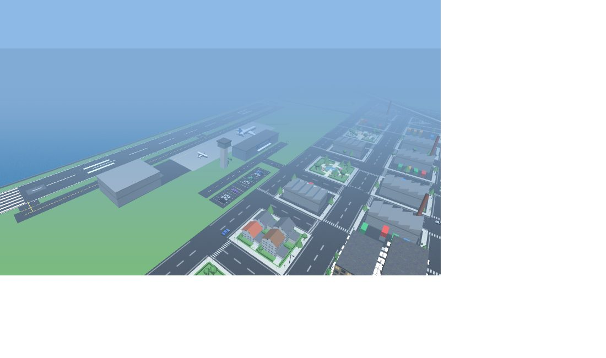 | 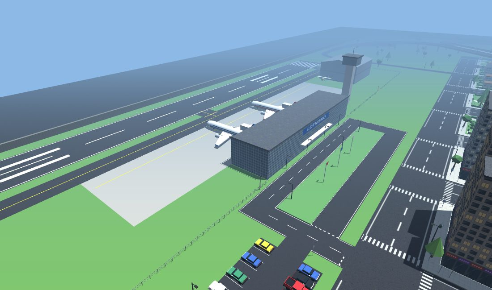 | 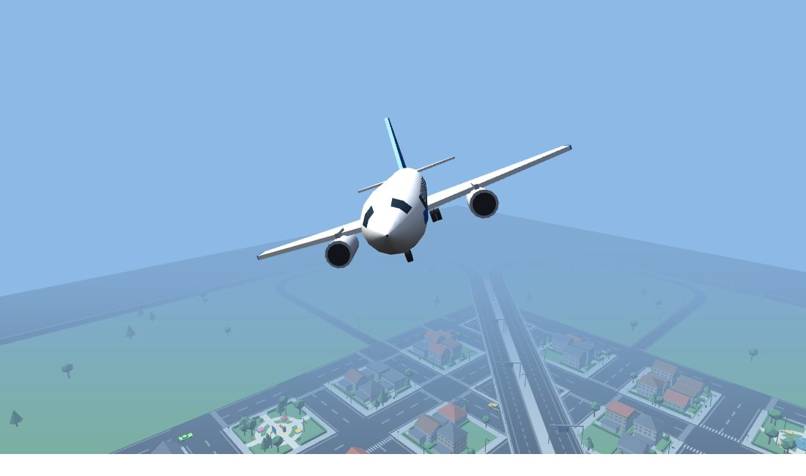 |

| Skok ze spadochronem | Katastrofa | Odrzutowiec |
|---|---|---|
| 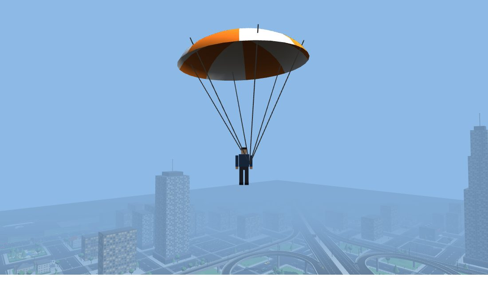 | 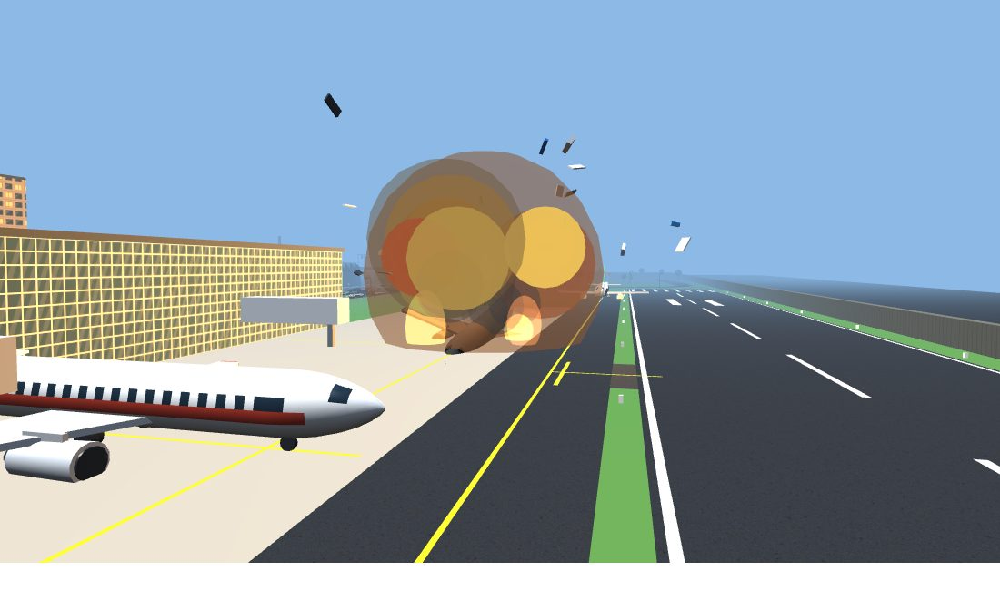 | 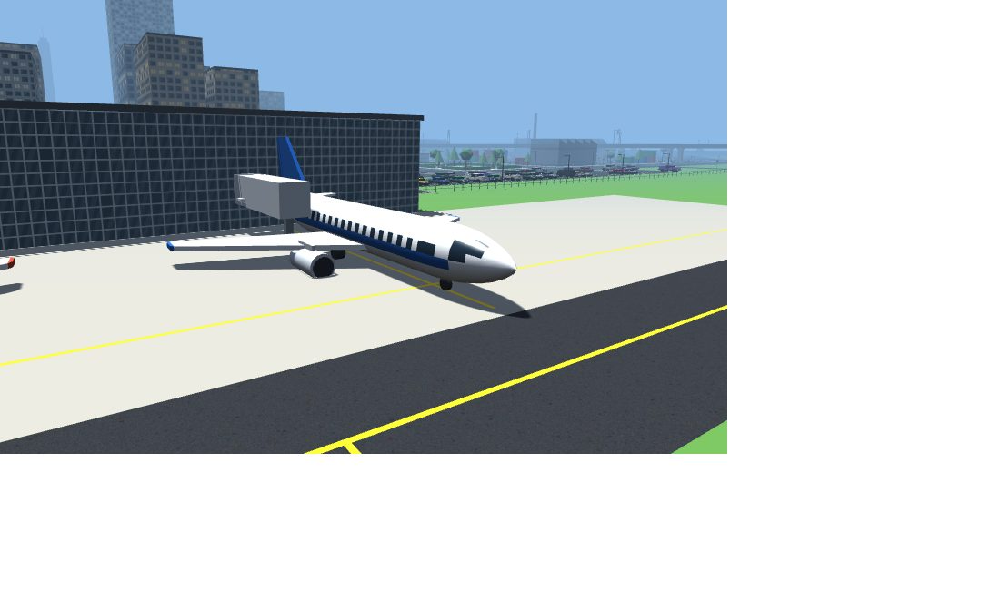 |

| Ruch lotniczy NPC — podejście do pasa 36L |
|---|
| 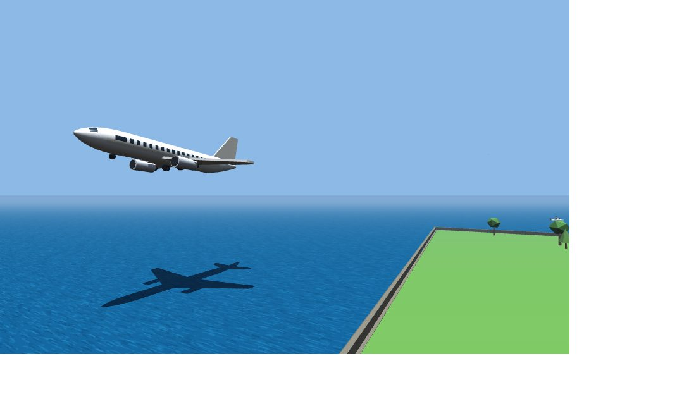 |

- **Dwa różne lotniska**: miejskie (regionalne) w zachodnim pasie zieleni wyspy głównej — pas 18L/36R (326 × 26 m) i drugi pas 18R/36L na nasypie przy brzegu, ceglany terminal z dachem dwuspadowym, ceglana wieża z ośmiokątną kabiną, dwa hangary łukowe, zbiorniki paliwa; oraz międzynarodowe na wysepce — pas 09R/27L (336 × 30 m) ze światłami podejścia i drugi, północny pas 09L/27R, terminal z łukowym dachem i rękawami, okrągła wieża ze szklaną kabiną, radar, cysterna i wózki bagażowe, hangar, parking, przystań. Na każdym stoi odrzutowiec i awionetka — można przelecieć z jednego na drugie.
- **Ruch lotniczy NPC** na drugich pasach: samoloty (odrzutowce i awionetka) startują, wznoszą się, przelatują na drugie lotnisko, podchodzą po ścieżce schodzenia (kierunek lądowania — krótsza trasa), lądują, hamują, zawracają na końcu pasa i startują z powrotem. Na pasie jest naraz jeden samolot — następny odchodzi na drugi krąg. Zderzenie twojego samolotu z NPC w powietrzu to katastrofa.
- Dwa samoloty: szybki odrzutowiec i zwrotna awionetka. Sterowanie strzałkami z autopoziomowaniem, ochroną przed przeciągnięciem i asystentem lądowania.
- `F` w locie — wyskakujesz, otwiera się prostokątna czasza (skręty `A`/`D`, `W` szybciej, `S` hamowanie), a samolot bez pilota nurkuje i rozbija się.
- Zderzenie z budynkiem albo twarde lądowanie to katastrofa: kula ognia przechodząca w dym, błysk, odłamki, płonący wrak, wstrząs kamery i huk. Pilot nie przeżywa (z nieśmiertelnością z menu debug ląduje obok wraku). Po kilkunastu sekundach samolot wraca na lotnisko — gdy jego stanowisko jest wolne.

### Menu deweloperskie (`` ` ``)

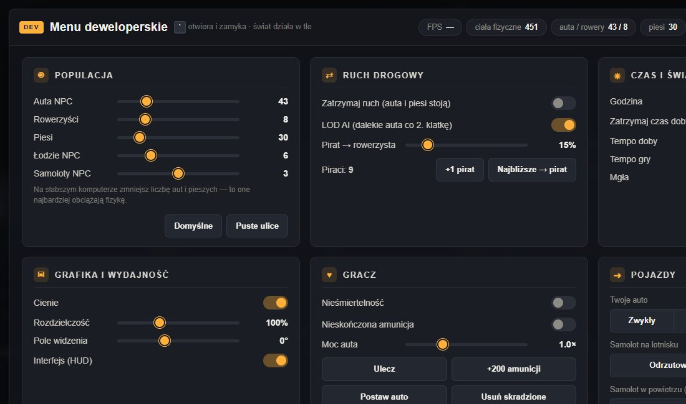

Pełnoekranowy panel z bieżącymi statystykami w nagłówku (FPS, ciała fizyczne, auta, piesi, łodzie, samoloty, tryb) i kartami w kolumnach — suwaki, przełączniki, przyciski:

- **Populacja**: auta NPC i piesi do 200, rowerzyści, łodzie i samoloty NPC; „Domyślne” i „Puste ulice”. Na słabszym komputerze wystarczy zmniejszyć liczbę aut i pieszych.
- **Ruch drogowy**: zatrzymanie ruchu, LOD AI, szansa potrącenia rowerzysty przez pirata, dodawanie piratów.
- **Czas i świat**: godzina, zatrzymanie i tempo doby, tempo gry (zwolnione tempo), mgła.
- **Grafika i wydajność**: cienie, rozdzielczość renderowania, pole widzenia, ukrycie HUD.
- **Gracz**: nieśmiertelność, nieskończona amunicja, moc auta, leczenie, amunicja, postawienie auta, usunięcie skradzionych aut.
- **Pojazdy, teleporty, nawigacja i ptaki**: typ auta, samolot na ziemi albo w powietrzu, łódź, 9 miejsc teleportu, szybki cel trasy, zrzut balastu.

### Ekran ładowania i pauza

| Ładowanie | Pauza |
|---|---|
| 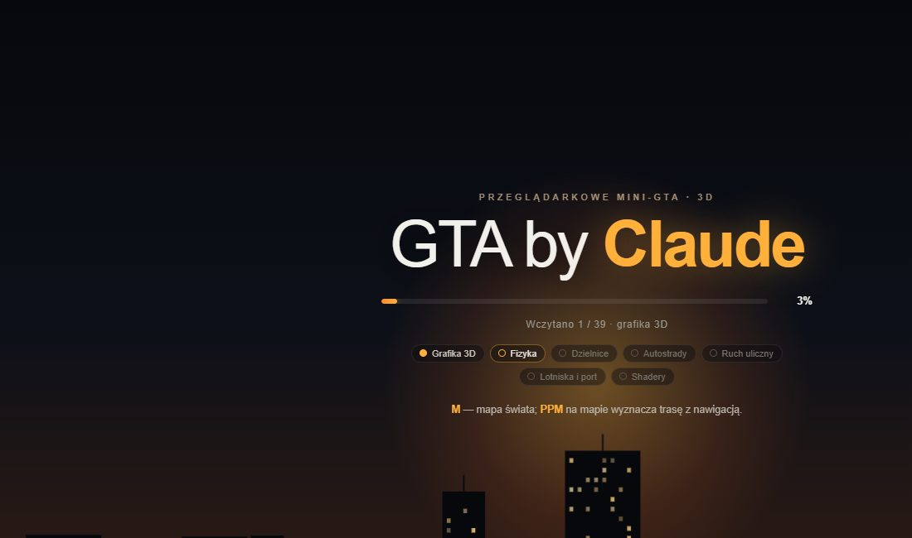 | 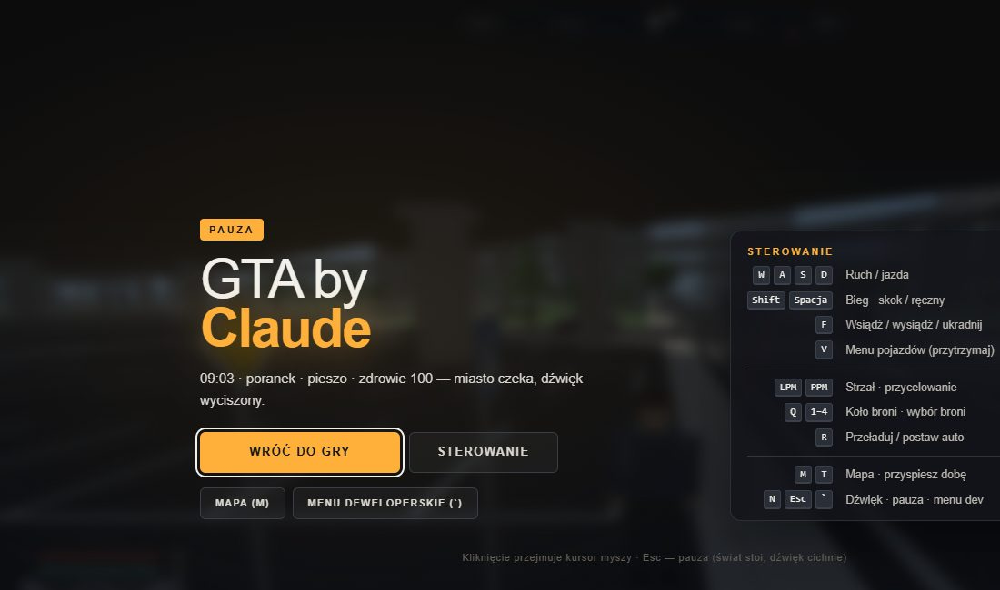 |

Ładowanie: sylwetka miasta o zmierzchu z mrugającymi oknami, pasek z procentem, etapy (grafika, fizyka, dzielnice, autostrady, ruch, lotniska, shadery) i zmieniające się wskazówki. Pauza (`Esc`): rozmyte zatrzymane miasto, stan gry w jednym wierszu, powrót, sterowanie, mapa, menu deweloperskie i ściągawka klawiszy (z aktualnych ustawień).

## Jak to jest zrobione

- **Three.js r128** (grafika) i **cannon.js 0.6.2** (fizyka) z CDN, reszta to czysty JavaScript bez frameworków. Dźwięk syntezuje Web Audio, tekstury rysuje Canvas 2D.
- 36 zwykłych skryptów ze wspólnym zakresem globalnym, ładowanych w kolejności z `loadorder.txt` (bez bundlera, więc gra działa z `file://`).
- Geometria miasta scalana w kilkadziesiąt siatek (ok. 200 wywołań rysowania), statyczne kolizje w komórkach 48 m.
- Auta NPC to ciała kinematyczne na trasach z punktów; skrzyżowania rozstrzygane wg czasu dojazdu, ronda, światła, kolejki, objazdy i zmiana pasa.

```
index.html        strona, style, HUD, ekran ładowania
loadorder.txt     kolejność ładowania skryptów
js/               kod gry (miasto, autostrady, lotnisko, auta, NPC, piesi, samoloty, HUD…)
test/             testy w Node: harness, symulacja ruchu, jazda prawdziwym autem, bundle
screenshots/      zrzuty do tego pliku
```

## Testy

```bash
npm install          # cannon@0.6.2 dla testu jazdy
npm test             # harness (wszystkie skrypty w Node) + 300 s symulacji ruchu
npm run test:drive   # jazda prawdziwym autem: autostrady, węzeł, zjazdy, kolizje, ronda, osiągi aut, zakaz rowerów (ok. 4 min)
npm run bundle       # cała gra w jednym pliku gta-by-claude-single.html
```

Symulacja (`node test/sim.js <sekundy>`, `SEED=…`) sprawdza m.in. nakładanie się aut, zakleszczenia, auta w budynkach, ronda, pieszych, przepisy, znaki i to, czy wszystko stoi na lądzie. Zmiany wizualne i lot samolotu są sprawdzane zrzutami z przeglądarki (Playwright).

## Ograniczenia

- Ulice to siatka ortogonalna, a trasy NPC to stałe pętle, nie graf dróg. Nawigacja gracza nie prowadzi przez autostrady (tylko ulice i dojazdy).
- Kolejki w parku jeżdżą po wyliczonym profilu prędkości (energia z wyciągu minus tarcie), a nie fizyką; z atrakcji (poza autodromem) nie można wysiąść w trakcie jazdy. Zwiedzający chodzą między punktami alejek bez kolizji; wagoniki i samochodziki nie zderzają się z pieszym graczem.
- Wyspy są prostokątne (sztuczne nabrzeża), łodzie to prosty model zręcznościowy (bez fal i fizyki wody); łodzie NPC pływają po losowych celach, nie po trasach.
- Uproszczony model lotu (bez wiatru i klap); samoloty NPC lecą po wyliczonej trasie (nie fizyką) i nie kołują po drogach kołowania — zawracają na końcu pasa. Samolot gracza zderza się z budynkami, terenem i samolotami NPC, nie z autami.
- Postać ma ręce z jednego segmentu — przy karabinie lewa dłoń tylko sięga w stronę łoża.
- Piraci biorą zakręty kinematycznie (bez prawdziwego poślizgu); potrącenie rowerzysty to zdarzenie skryptowe.
- AI dalekich aut liczone rzadziej, ale modele są pełne także z daleka.
- Piesi nie chodzą alejkami parków.
