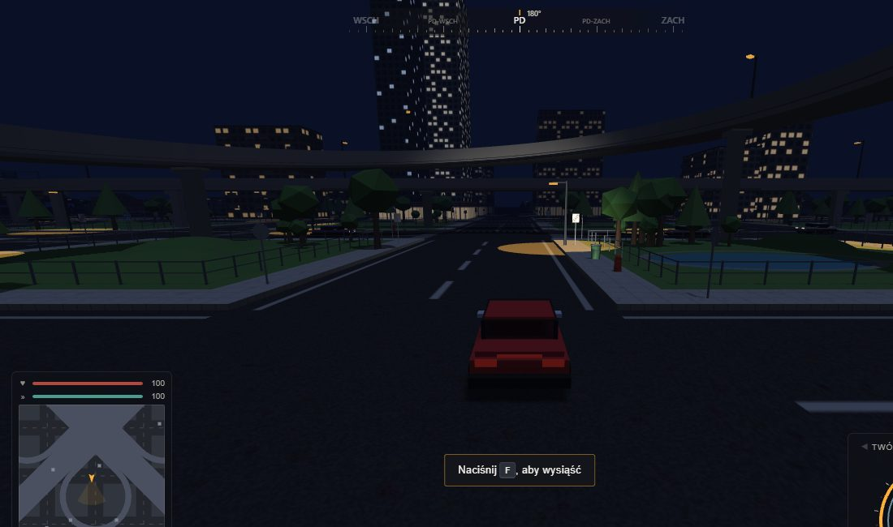
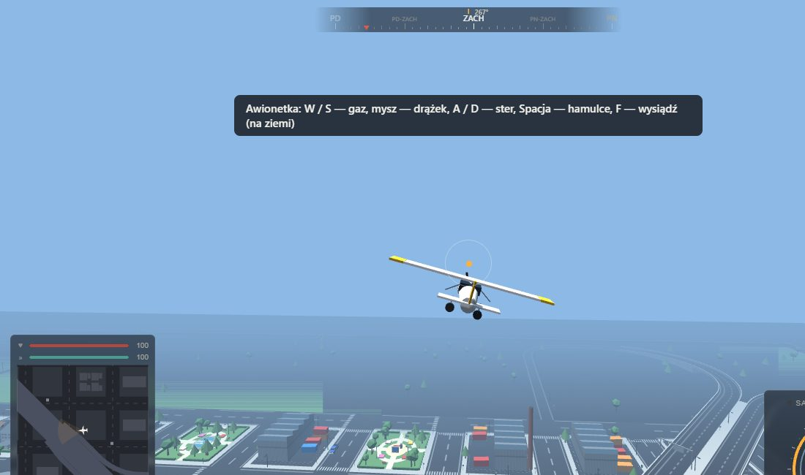

# GTA by Claude

**Mini-GTA w przeglądarce.** Miasto 12 × 12 kwartałów z ruchem ulicznym, pieszymi, rowerzystami i piratami drogowymi, dwie autostrady na estakadach z węzłem koniczynowym, lotnisko z samolotami, którymi można latać (i z których można wyskoczyć ze spadochronem), cykl dnia i nocy, broń i kradzież aut.

Wszystko — asfalt, okna, modele aut i samolotów, znaki, dźwięk silnika i wybuchów — jest generowane w kodzie. Nie ma ani jednego pliku graficznego czy dźwiękowego, nie ma bundlera ani serwera: wystarczy otworzyć `index.html`.


| Ulica w centrum | Noc | Węzeł koniczynowy |
|---|---|---|
|  |  |  |

## Jak zagrać

1. Pobierz repozytorium (`Code → Download ZIP` albo `git clone`).
2. Otwórz `index.html` w Chrome, Edge, Firefoksie albo Safari (dwuklik wystarczy).
3. Poczekaj na koniec ekranu ładowania i kliknij **WEJDŹ DO MIASTA**.

Potrzebny jest internet, bo Three.js i cannon.js ładują się z CDN. Jeśli wolisz serwer lokalny: `npx serve` albo `python3 -m http.server` w katalogu projektu.

## Sterowanie

Klawisze można zmienić w menu (**STEROWANIE**). `Esc` w trakcie gry to pauza — świat stoi, dźwięk cichnie.

**Pieszo**

| Klawisz | Akcja |
|---|---|
| `W` `A` `S` `D` / strzałki, mysz | ruch, kamera |
| `Shift` / `Spacja` | bieg / skok |
| `F` (albo `E`) | wsiądź do auta lub samolotu, ukradnij auto NPC |
| `V` (przytrzymaj) | menu pojazdów: twoje auto (zwykły, pickup, sportowy) albo rower |
| `1` `2` `3`, `Q` (przytrzymaj) | broń: pięści, kij, pistolet / koło broni |
| lewy przycisk myszy, `R` | atak, strzał / przeładowanie |

**W aucie**

| Klawisz | Akcja |
|---|---|
| `W` `S` / strzałki | gaz, hamulec, wsteczny |
| `A` `D` / strzałki | skręt |
| `Spacja` | hamulec ręczny (drift) |
| `Q` / `E` | lewy / prawy kierunkowskaz (gaśnie sam po skręcie) |
| `H` | klakson — auto stojące przed tobą rusza |
| `R` | postaw auto na koła |
| `F` | wysiądź |

**W samolocie**

| Klawisz | Akcja |
|---|---|
| `W` / `S` | więcej / mniej gazu |
| `↑` / `↓` | w górę / w dół (puszczone — samolot sam wraca do lotu poziomego) |
| `←` / `→` | skręt w przechyle (puszczone — skrzydła się wyrównują) |
| `A` / `D` | kołowanie po ziemi |
| `Spacja` | hamulce kół |
| `F` | wysiądź na ziemi, **w locie — skok ze spadochronem** |

**Na spadochronie**: `A` / `D` — skręt (czasza się przechyla), `W` — szybciej i stromiej, `S` — hamowanie (wolniej i łagodniej). Lądowanie jest bezpieczne.
| mysz | rozglądanie się (kamera wraca za ogon) |

Jak wystartować: ustaw samolot na pasie, trzymaj `W`, a gdy prędkościomierz pokaże ok. 160 km/h (awionetka ok. 85 km/h) — `↑`. Jak wylądować: podejdź nad pas na kilkadziesiąt metrów, zdejmij gaz (`S`) i puść strzałki — asystent lądowania sam zniży lot i łagodnie przyziemi, potem `Spacja`.

**Zawsze**: `T` — szybszy upływ doby, `M` — wyciszenie, `` ` `` — menu debug.

## Co jest w grze

### Miasto

| Rondo | Ulica pod estakadami | Park |
|---|---|---|
|  |  |  |

- **Dzielnice**: centrum z wieżowcami i placem z fontanną, dzielnica handlowa z galerią i parkingiem, przemysłowa (hale, kominy, kontenery), osiedla bloków z balkonami i domki z ogródkami i garażami. Do tego parki ze stawami i placami zabaw, stacja paliw, przystanki.
- **Autostrady A1 i A2** biegną estakadami po przekątnych miasta, z ulicami pod wiaduktami. W centrum — węzeł koniczynowy z pętlami, łącznicami i jezdniami zbierającymi, w narożnikach miasta zjazdy schodzące do poziomu ulic.
- **Przepisy i znaki**: ponad 970 znaków (STOP, ustąp pierwszeństwa, limity, strefa 30, droga z pierwszeństwem, zakaz wjazdu rowerów na autostradę i inne), sygnalizacja świetlna, ronda, jednokierunkowa obwodnica.
- **Dzień i noc**: słońce, księżyc, mgła, latarnie z plamami światła, oświetlone okna wieżowców.

### Ruch uliczny

| Pirat drogowy | Rowerzysta | Typy aut |
|---|---|---|
|  |  |  |

- **Auta NPC** (zwykłe, pickupy, sportowe; kierowcy ostrożni, zwykli i dynamiczni) jeżdżą prawostronnie, stają na czerwonym i na STOP, ustępują pierwszeństwa, objeżdżają ronda, włączają kierunkowskazy, wyprzedzają lewym pasem na autostradzie, omijają zaparkowane auta. Po stłuczce stają na światłach awaryjnych, na strzały uciekają.
- **Piraci drogowi** — kwasowo zielone auta (także na minimapie) z podrasowanym silnikiem. Nie przestrzegają żadnych przepisów: jadą na czerwonym, bez pierwszeństwa, praktycznie z prędkością maksymalną, slalomem, wyprzedzają przeciwnym pasem nawet na przejściach i potrącają pieszych i rowerzystów.
- **Rowerzyści** jeżdżą przy prawej krawędzi jezdni, auta wymijają ich z odstępem.
- **Piesi** spacerują po chodnikach i przechodzą po pasach (na światłach w swojej fazie).

### Ty

| HUD w aucie | W nocy | Szpital |
|---|---|---|
|  |  |  |

- Jazda z fizyką zawieszenia. Trzy typy aut: zwykły (0–100 km/h w 4,4 s, 181 km/h), pickup (6,9 s, 160 km/h), sportowy (3,0 s, 250 km/h), do tego rower. Twoje auto przywołujesz menu `V`, skradzione zostają tam, gdzie je porzucisz.
- Broń (pięści, kij, pistolet), zdrowie i kondycja, upadki z wysokości. Po śmierci odradzasz się przed **szpitalem** w południowym pasie zieleni (dojazd z obwodnicy, lądowisko na dachu, karetki, parking).
- HUD: kompas, zegarowy prędkościomierz, zegar, minimapa z całym światem.

### Lotnisko i samoloty

| Lotnisko | Odrzutowiec w locie | Awionetka |
|---|---|---|
|  |  |  |

| Skok ze spadochronem | Katastrofa | Odrzutowiec |
|---|---|---|
|  |  |  |

- Lotnisko na północ od miasta: pas startowy 336 × 30 m, droga kołowania, płyta z rękawami, terminal, wieża, hangar, parking.
- Dwa samoloty: szybki odrzutowiec i zwrotna awionetka. Sterowanie strzałkami z autopoziomowaniem, ochroną przed przeciągnięciem i asystentem lądowania.
- `F` w locie — wyskakujesz, otwiera się prostokątna czasza (skręty `A`/`D`, `W` szybciej, `S` hamowanie), a samolot bez pilota nurkuje i rozbija się.
- Zderzenie z budynkiem albo twarde lądowanie to katastrofa: kula ognia przechodząca w dym, błysk, odłamki, płonący wrak, wstrząs kamery i huk. Pilot nie przeżywa (z nieśmiertelnością z menu debug ląduje obok wraku). Po kilkunastu sekundach samolot wraca na lotnisko — gdy jego stanowisko jest wolne.

### Menu debug (`` ` ``)

Liczba aut i pieszych, pora dnia, nieśmiertelność, amunicja, teleporty (start, lotnisko, autostrada, zjazd, obwodnica), zmiana typu auta w trakcie jazdy i rower, kierunkowskazy, samolot na lotnisku albo od razu w powietrzu, dodawanie piratów i rowerzystów, szansa potrącenia rowerzysty, przełącznik LOD.


## Jak to jest zrobione

- **Three.js r128** (grafika) i **cannon.js 0.6.2** (fizyka) z CDN, reszta to czysty JavaScript bez frameworków. Dźwięk syntezuje Web Audio, tekstury rysuje Canvas 2D.
- 31 zwykłych skryptów ze wspólnym zakresem globalnym, ładowanych w kolejności z `loadorder.txt` (bez bundlera, więc gra działa z `file://`).
- Geometria miasta scalana w kilkadziesiąt siatek (ok. 200 wywołań rysowania), statyczne kolizje w komórkach 48 m.
- Auta NPC to ciała kinematyczne na trasach z punktów; skrzyżowania rozstrzygane wg czasu dojazdu, ronda, światła, kolejki, objazdy i zmiana pasa.

```
index.html        strona, style, HUD, ekran ładowania
loadorder.txt     kolejność ładowania skryptów
js/               kod gry (miasto, autostrady, lotnisko, auta, NPC, piesi, samoloty, HUD…)
test/             testy w Node: harness, symulacja ruchu, jazda prawdziwym autem, bundle
screenshots/      zrzuty do tego pliku
```

## Testy

```bash
npm install          # cannon@0.6.2 dla testu jazdy
npm test             # harness (wszystkie skrypty w Node) + 300 s symulacji ruchu
npm run test:drive   # jazda prawdziwym autem: autostrady, węzeł, zjazdy, kolizje, ronda, osiągi aut, zakaz rowerów (ok. 4 min)
npm run bundle       # cała gra w jednym pliku gta-by-claude-single.html
```

Symulacja (`node test/sim.js <sekundy>`, `SEED=…`) sprawdza m.in. nakładanie się aut, zakleszczenia, auta w budynkach, ronda, pieszych, przepisy i znaki. Zmiany wizualne i lot samolotu są sprawdzane zrzutami z przeglądarki (Playwright).

## Ograniczenia

- Ulice to siatka ortogonalna, a trasy NPC to stałe pętle, nie graf dróg.
- Uproszczony model lotu (bez wiatru i klap), brak samolotów NPC; samolot zderza się z budynkami i terenem, nie z autami.
- Piraci biorą zakręty kinematycznie (bez prawdziwego poślizgu); potrącenie rowerzysty to zdarzenie skryptowe.
- AI dalekich aut liczone rzadziej, ale modele są pełne także z daleka.
- Piesi nie chodzą alejkami parków.
